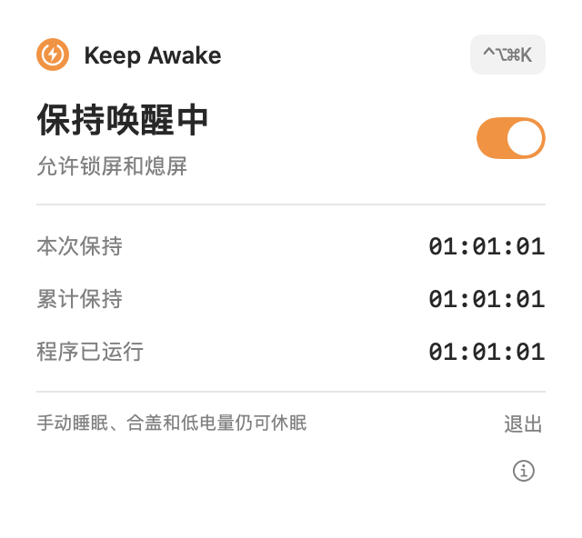

# Keep Awake

一个 macOS 菜单栏小工具，用来防止电脑因长时间没有键鼠操作而进入闲置休眠。开启后仍可锁屏和熄屏；手动睡眠、合盖或低电量等情况仍可能使电脑休眠。



## 功能

- 点击菜单栏图标，在面板中切换保持唤醒；也可使用全局快捷键 `⌃⌥⌘K`（Control + Option + Command + K）。
- 橙黄色实心闪电表示保持唤醒已开启；绿色轮廓表示未开启且最近 120 秒有键鼠操作；灰色轮廓表示未开启且处于闲置状态。绿色不代表防休眠已开启。
- 显示本次或上次保持时长、累计保持时长和程序运行时长；开启期间菜单栏还会显示本次时长。
- 单实例运行；快捷键注册、系统断言或统计读写出错时在面板中提示。

## 运行

需要 macOS 13 或更新版本、Apple Silicon，以及 Swift 6 工具链（Xcode 或 Command Line Tools）。在项目目录运行：

```sh
swift run keep-awake
```

程序在菜单栏运行，不显示 Dock 图标。默认不启用保持唤醒；点击图标使用开关，或按 `⌃⌥⌘K` 切换。点击面板中的「退出」可退出程序并解除本工具的防休眠限制。

如需启动时立即开启：

```sh
swift run keep-awake --keep-awake-on
```

项目没有内置登录项配置，也尚未提供打包好的应用或安装程序。第二次启动不会改变已运行实例的开关状态。

## 时长与数据

累计时长保存在 `~/Library/Application Support/keep-awake/stats.json`，单实例锁文件位于同一目录。保持开启时，程序约每 60 秒清醒运行时间保存一次；停止或正常退出时也会结算。异常退出可能丢失上次成功保存之后的时长。

时长使用单调的系统运行时钟，不受日期调整影响，也不计系统实际休眠时间；锁屏或熄屏期间仍计时。读取统计失败时程序保留原文件并禁止覆盖；写入失败时保留内存中的累计值并尝试重新保存。

## 开发与验证

```sh
swift build
sh scripts/test.sh
```

测试脚本兼容仅安装 Command Line Tools 的环境：该环境中测试构建使用 macOS 14 部署目标，应用本身仍以 macOS 13 为最低目标。

面板预览和定位自检：

```sh
swift run keep-awake --render-preview /tmp/ka-preview.png
swift run keep-awake --demo-popover
```

实现使用 Swift、SwiftUI、AppKit、IOKit 和 Carbon。IOKit 电源断言用于防止系统闲置休眠，全局快捷键使用 Carbon 注册。

## 许可证

本仓库暂未指定开源许可证；如需使用或再分发，请先联系仓库所有者。
