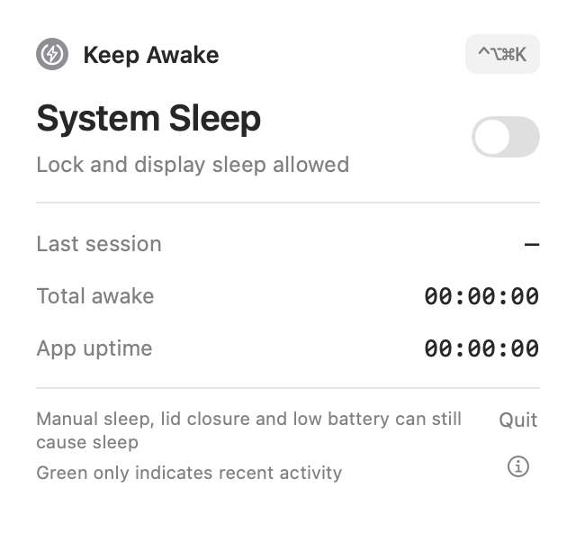
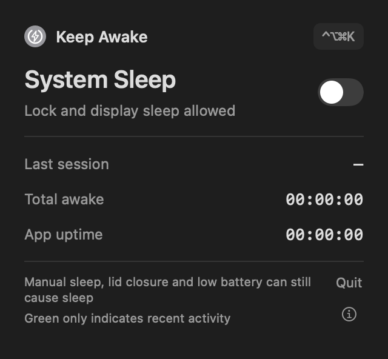
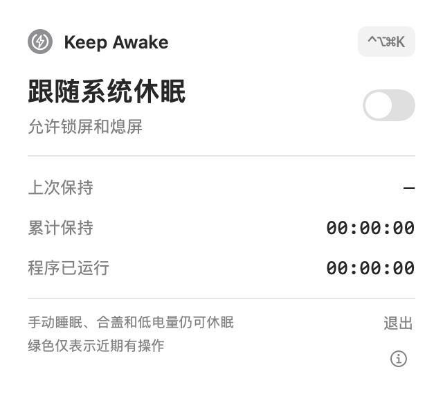
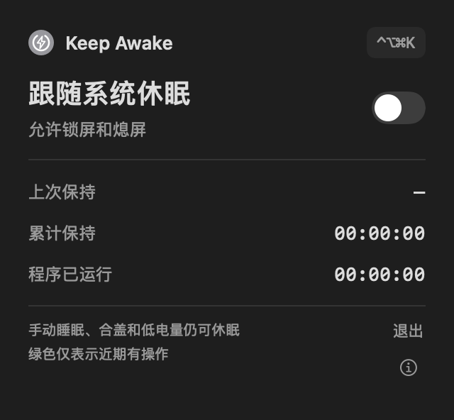

# Keep Awake

[English](#english) | [简体中文](#简体中文)

## English

Keep Awake is a macOS menu bar utility that prevents idle system sleep while allowing the screen to turn off and the Mac to lock. Manual sleep, closing the lid, low battery, and other forced sleep conditions can still put the Mac to sleep. The interface follows the system language (Chinese or English, with English as the fallback).

| Light mode | Dark mode |
| --- | --- |
|  |  |

### Features

- Toggle keep-awake from the menu bar panel or with the global shortcut `⌃⌥⌘K` (Control + Option + Command + K).
- Click the duration (initially **2 h**) to select a timer, or double-click it to edit in `HH:MM` format from `00:01` through `24:00`. Use the switch or shortcut to start. When the countdown ends, the Mac returns to its normal sleep settings. Choose **Unlimited** for an open-ended session.
- An orange filled bolt means keep-awake is on. A green outlined bolt means it is off and there has been keyboard or mouse input in the last 120 seconds; gray means it is off and idle. Green does not mean sleep prevention is on.
- View the current or last session, total keep-awake time, and app uptime. The menu bar also shows the current session duration while enabled.
- Only one instance runs at a time. The panel reports hotkey registration, power assertion, and statistics read/write errors.
- If the shortcut is in use by another app, resolve the conflict and choose **Retry shortcut** in the alert details. This keeps the current session running.

### Download and run

Download the Apple Silicon app from [GitHub Releases](https://github.com/wwq0327/keep-awake/releases/latest), unzip it, and open `Keep Awake.app`. It requires macOS 13 or later. The app is not signed with an Apple Developer certificate or notarized; on first launch, macOS may require you to allow it under System Settings → Privacy & Security.

The app appears in the menu bar without a Dock icon. Keep-awake is off by default: click the icon and use the switch, or press `⌃⌥⌘K`. Use the panel's quit button to exit and release this app's sleep-prevention assertion.

To build and run from source, install Swift 6 (Xcode or Command Line Tools) and run:

```sh
swift run keep-awake
```

To enable keep-awake on launch:

```sh
swift run keep-awake --keep-awake-on
```

There is no built-in login item configuration. Launching a second instance does not change the running instance's switch.

### Time and data

Accumulated time is stored in `~/Library/Application Support/keep-awake/stats.json`; the single-instance lock file is in the same directory. While enabled, the app saves approximately every 60 seconds of awake runtime and also settles the total when stopped or quit normally. An abnormal exit can lose time since the last successful save.

Durations use a monotonic uptime clock, are unaffected by date changes, and exclude actual system sleep; they continue while the screen is locked or off. If statistics cannot be read, the original file is preserved and not overwritten. If a write fails, the in-memory total is retained and saving is retried.

Unsupported numeric values in historical statistics are treated as unreadable data and preserved. They do not prevent the current session from running.

### Development and verification

```sh
swift build
sh scripts/test.sh
```

The test script supports Command Line Tools-only environments. In that environment, tests use a macOS 14 deployment target; the app itself targets macOS 13 and later.

Panel preview and positioning checks:

```sh
swift run keep-awake --render-preview /tmp/ka-preview.png
swift run keep-awake --demo-popover
```

Built with Swift, SwiftUI, AppKit, IOKit, and Carbon. An IOKit power assertion prevents idle system sleep; Carbon registers the global hotkey.

### License

[MIT License](LICENSE).

---

## 简体中文

一个 macOS 菜单栏小工具，用来防止电脑因长时间没有键鼠操作而进入闲置休眠。开启后仍可锁屏和熄屏；手动睡眠、合盖或低电量等情况仍可能使电脑休眠。界面跟随系统语言显示中文或英文，其他语言默认显示英文。

| 浅色模式 | 深色模式 |
| --- | --- |
|  |  |

### 功能

- 点击菜单栏图标，在面板中切换保持唤醒；也可使用全局快捷键 `⌃⌥⌘K`（Control + Option + Command + K）。
- 单击时长（初始为「2 小时」）选中限时模式，双击可在原位按 `小时:分钟` 修改，范围为 `00:01` 到 `24:00`。用开关或快捷键启动，到点恢复按系统设置休眠。选「不限时」可持续保持。
- 橙黄色实心闪电表示保持唤醒已开启；绿色轮廓表示未开启且最近 120 秒有键鼠操作；灰色轮廓表示未开启且处于闲置状态。绿色不代表防休眠已开启。
- 显示本次或上次保持时长、累计保持时长和程序运行时长；开启期间菜单栏还会显示本次时长。
- 单实例运行；快捷键注册、系统断言或统计读写出错时在面板中提示。
- 快捷键被其他应用占用时，解除冲突后可在提示详情中点击「重试快捷键」，不会中断本次保持。

### 运行

需要 macOS 13 或更新版本及 Apple Silicon。从源码运行还需要 Swift 6 工具链（Xcode 或 Command Line Tools）。在项目目录运行：

```sh
swift run keep-awake
```

程序在菜单栏运行，不显示 Dock 图标。默认不启用保持唤醒；点击图标使用开关，或按 `⌃⌥⌘K` 切换。点击面板中的「退出」可退出程序并解除本工具的防休眠限制。

如需启动时立即开启：

```sh
swift run keep-awake --keep-awake-on
```

也可以从 [GitHub Releases](https://github.com/wwq0327/keep-awake/releases/latest) 下载 Apple Silicon 应用包。该应用未经 Apple 开发者签名或公证，首次打开时可能需要在「系统设置 → 隐私与安全性」中允许打开。项目没有内置登录项配置；第二次启动不会改变已运行实例的开关状态。

### 时长与数据

累计时长保存在 `~/Library/Application Support/keep-awake/stats.json`，单实例锁文件位于同一目录。保持开启时，程序约每 60 秒清醒运行时间保存一次；停止或正常退出时也会结算。异常退出可能丢失上次成功保存之后的时长。

时长使用单调的系统运行时钟，不受日期调整影响，也不计系统实际休眠时间；锁屏或熄屏期间仍计时。读取统计失败时程序保留原文件并禁止覆盖；写入失败时保留内存中的累计值并尝试重新保存。

历史统计中不支持的数值按读取异常处理并保留原文件，不影响当前进程继续保持和计时。

### 开发与验证

```sh
swift build
sh scripts/test.sh
```

测试脚本兼容仅安装 Command Line Tools 的环境：该环境中测试构建使用 macOS 14 部署目标，应用本身仍以 macOS 13 为最低目标。

面板预览和定位自检：

```sh
swift run keep-awake --render-preview /tmp/ka-preview.png
swift run keep-awake --demo-popover
```

实现使用 Swift、SwiftUI、AppKit、IOKit 和 Carbon。IOKit 电源断言用于防止系统闲置休眠，全局快捷键使用 Carbon 注册。

### 许可证

本项目以 [MIT 许可证](LICENSE)开源。
